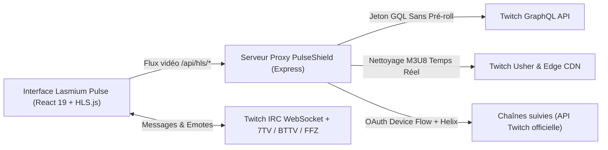

<div align="center">


# LASMIUM *Pulse* `04`

**Visualiseur Twitch moderne • Multi-vue jusqu'à 9 écrans • Bloqueur de publicités HLS • Chat hybride • Compte Twitch**

[](https://github.com/lasme-ephrem/lasmium-pulse/actions)
[](https://react.dev/)
[](https://www.typescriptlang.org/)
[](https://vite.dev/)
[](LICENSE)

<p align="center">
  <em>Tous vos lives Twitch sans interruption publicitaire, jusqu'à 9 écrans simultanés, dans une interface éditoriale inspirée du design industriel (clair, sombre, OLED).</em>
</p>

<p align="center"><a href="README.md">🇬🇧 English version</a></p>
<p align="center">
</p>

</div>

---

##  Points Forts

| Fonctionnalité | Description |
| :--- | :--- |
|  **PulseShield™ Anti-Pub HLS** | Proxy local Node.js interceptant les manifestes `.m3u8` de `usher.ttvnw.net`, générant des jetons sans pré-roll et purgeant en temps réel les segments publicitaires (`stitched-ad`). |
|  **Multi-Vue jusqu'à 9 Écrans** | De **1 à 9 streams en simultané** (4 par défaut, réglable) avec 5 dispositions : **Grille**, **Focus** (principal + colonne), **Théâtre** (principal + bandeau), **Colonnes** et **Studio/Cinéma**. Écrans réordonnables par **glisser-déposer** (souris ou clavier), lien Twitch déposable sur la grille. |
|  **Audio Solo Intelligent** | Cliquez sur n'importe quel écran pour écouter instantanément son flux audio et couper automatiquement les autres. Le volume est **mémorisé par chaîne**. |
|  **Lecteur complet** | **Qualité plafonnée** sur les écrans secondaires (720p par défaut, économise la bande passante), mode **audio seul**, **statistiques techniques**, **capture d'écran** PNG, **retour arrière** dans le live (2 min gardées en mémoire, réglable) avec **décalage par écran** et bouton **Aligner** pour voir le même instant sur chaque angle, **clip local** des dernières secondes (fichier brut immédiat ou MP4 remuxé par ffmpeg.wasm dans le navigateur), **fenêtre flottante** toujours au premier plan (Chrome/Edge). |
|  **Chat Hybride (Rapide & Officiel)** | **Mode Rapide** ultra-fluide (liste virtualisée, jusqu'à 1 000 messages par chaîne) avec emotes Twitch + **7TV / BTTV / FFZ**, **sélecteur d'emotes** et autocomplétion `:` / `@`, filtre de recherche, onglet **Mix** qui fusionne les chats de tous les écrans, **événements du chat** (abonnements, raids, annonces, bits, messages supprimés, timeouts et bans), liens cliquables, **alerte de mention** (surlignage, son et notification en option), **filtres** (bots, commandes, emotes seules, mots et pseudos masqués, liste de blocage Twitch), **fiche viewer** (profil, mention, réponse, blocage, **outils de modération** sur les chaînes que vous modérez), liste des **viewers**, **chat détachable** dans sa propre fenêtre et **envoi de messages avec votre compte Twitch** (réponses en fil comme sur Twitch, vos messages surlignés). Bascule en 1 clic vers le **Chat Officiel Twitch** (iframe). |
|  **Chaînes suivies & Recommandations** | Barre latérale façon Twitch : vos **chaînes suivies** en direct (connexion Twitch officielle), des **chaînes live** et **catégories recommandées** selon ce que vous suivez, ajoutables en 1 clic. |
|  **Fin de live détectée** | Quand un stream se termine, l'écran affiche **LIVE TERMINÉ** (durée, rediffusions, fermeture) au lieu de rester figé ; une chaîne hors ligne redémarre toute seule si le live reprend. |
|  **Notifications de live** | Toast dans l'app (et notification du navigateur en option) quand une chaîne suivie lance un live, avec bouton **Regarder** ; **cloche par chaîne** pour en couper certaines, **historique** des notifications dans les réglages, et **prochain live planifié** affiché sous les chaînes hors ligne. |
|  **Temps réel Twitch (EventSub)** | Connecté à Twitch, le serveur reçoit en direct les **changements de titre et de catégorie** des écrans ouverts, la **fin d'un live**, les **raids** (toast **Suivre le raid**) et les lives des chaînes suivies, dans la limite d'abonnements imposée par Twitch ; l'interrogation périodique reste en secours. |
|  **Presets & reprise** | **Enregistrez une multi-vue** (chaînes, disposition, volumes) et relancez-la d'un clic depuis la barre du haut ou l'accueil ; l'**historique des sessions** propose de reprendre les dernières multi-vues. |
|  **Palette de commandes** | `Ctrl+K` : chaînes (suivies, récentes, recherche Twitch) et actions (dispositions, Solo, chat, presets, réglages…) depuis une seule zone de saisie, au clavier. |
|  **Catégories & Clips** | Parcourez les **catégories** les plus regardées ou cherchez-en une, filtrez le répertoire des directs dessus (avec « Afficher plus »), et regardez les **clips** les plus vus d'une chaîne ou d'une catégorie (24 h, 7 jours, 30 jours, toujours) dans l'app. |
|  **Rediffusions (VOD)** | Lecture fiable via le relais local (le CDN des VOD refuse les requêtes directes du navigateur), vitesse 0,5× à 2×, **chapitres** (changements de jeu) cliquables, barre de position, et **chat de la rediffusion synchronisé** avec la vidéo dans le panneau de chat. Les VOD réservées aux abonnés restent inaccessibles. |
|  **Session & Lien partageable** | La multi-vue survit au rafraîchissement et l'URL (`?c=chaine1,chaine2&layout=spotlight`) se partage telle quelle. |
|  **Multilingue (FR / EN)** | Langue détectée automatiquement depuis le navigateur (anglais par défaut), sélecteur dans la barre du haut avec choix mémorisé ; nombres, heures, catégories Twitch suivent la langue. Le « Top » du répertoire et les recommandations suivent la langue de l'interface par défaut, ou une autre langue de streams au choix (FR, EN, ES, DE…). |
|  **Clips Twitch** | Bouton **Clip** sur chaque écran (touche `X`) : crée un vrai clip Twitch des dernières secondes depuis votre compte, puis lien vers la page d'édition de Twitch. |
|  **Réglages unifiés** | Un seul panneau (touche `,`) : langue, thème **système / clair / sombre / noir OLED**, couleur d'accent, langue des streams, chat, notifications, anti-pub, raccourcis, **export / import** de toutes vos données et « À propos ». Tout est mémorisé, y compris Solo, Sync chat et le mode de chat. |
|  **Raccourcis clavier & Sync live** | `1–9`, `M`, `S`, `F`, `L`, `R`, `X`, `,`… (aide avec `?`), **touches personnalisables**, et resynchronisation de tous les écrans sur le direct, avec affichage de la latence. |
|  **Annuler & confort** | Fermer un écran se défait d'un clic (toast **Annuler**), l'onglet affiche `🔴 chaîne +2 · 46 k` avec un badge sur le favicon, transitions animées entre dispositions, visite guidée au premier lancement, navigation complète au clavier (dialogues accessibles, focus visible, `prefers-reduced-motion` respecté). |
|  **Thèmes** | Direction artistique **Broadcast Studio** (*Papier d'Atelier `#F4F1EA`* en clair, *Console Carbone `#0D0D0C`* en sombre, **noir pur** pour OLED), suit le thème du système par défaut, 8 couleurs d'accent. |
|  **Lecteur de Liens Universel** | Collez n'importe quel lien Twitch (`twitch.tv/chaine`, `twitch.tv/videos/...`, ou plusieurs liens d'un coup) ou explorez directement le **Top France** et **Monde**. |

---

##  Architecture



---

##  Installation & Démarrage Rapide

### Application de bureau (Windows, macOS, Linux)

Téléchargez l'installeur de la dernière [release](https://github.com/lasme-ephrem/lasmium-pulse-releases/releases) : `.exe` (Windows), `.dmg` (macOS), `.AppImage` ou `.deb` (Linux). L'application embarque le serveur local, garde la session Twitch dans le coffre du système (`safeStorage`) et se **met à jour toute seule** depuis les GitHub Releases (toast « Mise à jour prête » → Redémarrer). Les paquets ne sont pas encore signés : Windows SmartScreen et macOS Gatekeeper affichent un avertissement au premier lancement (macOS : clic droit → Ouvrir). Sur Ubuntu / Debian, préférez le `.deb` (entrée de menu et icône du dock installées) ; une AppImage lancée telle quelle garde une icône générique tant qu'elle n'est pas intégrée (Gear Lever, AppImageLauncher).

La connexion Twitch ne demande aucune configuration : **Se connecter avec Twitch** dans la barre latérale, puis le code à valider sur `twitch.tv/activate` (chacun avec son propre compte).

### Docker (auto-hébergement)

```bash
PULSE_SECRET='une-longue-chaine-aleatoire' PULSE_PASSWORD='un-mot-de-passe' docker compose up -d
# → http://<machine>:3001
```

`PULSE_SECRET` chiffre la session Twitch sur le volume ; `PULSE_PASSWORD` est demandé par le navigateur avant tout accès (indispensable dès qu'une autre machine atteint le serveur). La connexion Twitch fonctionne sans variable supplémentaire (`TWITCH_APP_CLIENT_ID` permet d'utiliser votre propre application Twitch). L'image est publiée sur `ghcr.io/lasme-ephrem/lasmium-pulse` à chaque version (`docker.yml`) ; `docker build -t lasmium-pulse .` la construit depuis les sources.

### Depuis les sources

### Prérequis
- **Node.js** `>= 22.13` (testé avec Node 22 & 24 ; la bibliothèque utilise le SQLite intégré à Node)
- **npm** `>= 10.x`

### Lancer l'application en développement

```bash
# 1. Cloner le dépôt
git clone https://github.com/lasme-ephrem/lasmium-pulse.git
cd lasmium-pulse

# 2. Installer les dépendances
npm install

# 3. (Optionnel) Configurer la connexion Twitch et les ports
cp .env.example .env

# 4. Démarrer simultanément le proxy anti-pub (port 3001) et l'interface web (port 5173)
#    (npm run build && npm start : un seul serveur de production sur http://127.0.0.1:3001)
npm run dev
```

Rendez-vous ensuite sur **[http://localhost:5173](http://localhost:5173)**.

### Connexion Twitch (chaînes suivies & notifications)

La liste des chaînes suivies n'est accessible qu'avec l'accord de votre compte. Lasmium Pulse utilise le **Device Code Flow** officiel de Twitch (aucun mot de passe ni secret stocké dans l'app) : cliquez sur **Se connecter avec Twitch** dans la barre latérale et validez le code affiché sur `twitch.tv/activate`. Rien à configurer : l'application embarque le Client ID public de l'application Twitch du projet (un identifiant d'application, pas un secret), et chaque personne se connecte avec son propre compte.

Pour utiliser **votre propre application Twitch** à la place (optionnel) :

1. Créez une application sur **[dev.twitch.tv/console/apps/create](https://dev.twitch.tv/console/apps/create)** : URL de redirection `http://localhost`, catégorie *Application Integration*, **type de client : Public**.
2. Copiez son **Client ID** dans `.env` : `TWITCH_APP_CLIENT_ID=...` (application de bureau : le chemin du `.env` est affiché dans Réglages → À propos).
3. Redémarrez l'application.

Permissions demandées : `user:read:follows` (chaînes suivies), `user:write:chat` (écrire depuis le chat Rapide), `clips:edit` (créer des clips), `user:read:emotes` (vos emotes dans le sélecteur), `user:read:blocked_users` / `user:manage:blocked_users` (liste de blocage Twitch), `user:read:moderated_channels`, `moderator:manage:chat_messages`, `moderator:manage:banned_users` et `moderator:read:chatters` (outils de modération et liste des viewers, **uniquement** sur les chaînes dont vous êtes modérateur). Une session ouverte avant l'ajout d'une permission demande de se reconnecter une fois (**Autoriser l'écriture** dans le chat, au premier clic sur **Clip**, ou depuis la fiche d'un viewer) ; l'app n'utilise jamais ces permissions sans une action explicite de votre part.

Le jeton est conservé uniquement côté serveur local dans `server/data/auth.json` (ignoré par git), **chiffré** dès que `PULSE_SECRET` est défini dans `.env` (sinon un avertissement s'affiche au démarrage). Sans `.env`, tout le reste de l'application fonctionne normalement.

### Lancer plusieurs copies en parallèle

`PULSE_SERVER_PORT` et `PULSE_CLIENT_PORT` dans `.env` permettent par exemple de lancer un worktree sur `3002` / `5174` à côté de la version principale.

### Variables d'environnement

| Variable | Rôle | Défaut |
| :--- | :--- | :--- |
| `TWITCH_APP_CLIENT_ID` | Client ID d'une application Twitch « Public » à utiliser à la place de celui embarqué dans l'app. | *(Client ID du projet)* |
| `PULSE_SERVER_PORT` / `PULSE_CLIENT_PORT` | Ports du proxy et du client Vite. | `3001` / `5173` |
| `PULSE_SECRET` | Clé (16 caractères minimum) qui chiffre la session Twitch sur le disque. | *(vide : session en clair)* |
| `PULSE_PASSWORD` | Mot de passe HTTP (8 caractères minimum) demandé avant tout accès. | *(aucun)* |
| `PULSE_SENTRY_DSN` | DSN Sentry des rapports d'erreurs anonymes ; restent désactivés tant que l'interrupteur des réglages est éteint. | *(aucun)* |
| `PULSE_ALLOW_LAN` | `1` pour accepter d'autres machines (Docker, serveur maison). | `0` : écoute sur `127.0.0.1` seulement |
| `PULSE_ALLOWED_HOSTS` | Noms d'hôte supplémentaires acceptés (ex. `pulse.local`). | *(vide)* |
| `PULSE_DATA_DIR` | Dossier des données (session, statistiques, bibliothèque SQLite). | `server/data` |
| `PULSE_LOG_LEVEL` | `fatal` … `trace`, `silent`. | `info` |

La configuration est validée au démarrage (`server/env.ts`, schéma `zod`) : une valeur invalide arrête le serveur avec un message explicite.

---

##  Distribution

- **Bureau** : `npm run desktop` lance la coque Electron sur la version construite (avec npm ≥ 11.6, autorisez d'abord le script d'installation d'Electron : `npm approve-scripts electron`) ; `npm run desktop:dist` (ou `:win`, `:mac`, `:linux`) produit les paquets dans `release/` (`electron-builder.yml`). Le workflow `release.yml` construit les trois systèmes à chaque tag `vX.Y.Z` créé par release-please et attache les fichiers à la GitHub Release lue par `electron-updater`.
- **Docker** : `Dockerfile` multi-étapes (Node 22 slim, image finale sans dépendances de développement, utilisateur non root, volume `/data`, bilan de santé), `compose.yml`, publication sur GHCR (`docker.yml`).
- **Web installable (PWA)** : le client construit s'installe depuis le navigateur (manifeste et icônes générés par `vite-plugin-pwa`) ; seul le coffre de l'application est mis en cache, jamais l'API ni la vidéo. Sur téléphone, la disposition passe en colonne : écrans empilés, chat en tiroir sous les écrans.
- **Manifestes** : `packaging/winget/` et `packaging/homebrew/` sont prêts à soumettre une fois la première release publiée ; `npx lasmium-pulse` est préparé par le champ `bin` (publication npm à activer).
- **Tests de bout en bout** : `npm run test:e2e` (Playwright, API locale simulée), joués en CI.
- **Rapports d'erreurs** : Sentry côté client et serveur, **désactivé par défaut**, activable dans Réglages → Données quand `PULSE_SENTRY_DSN` est défini ; aucun identifiant, jeton ni nom de chaîne n'est envoyé.

##  Sécurité du serveur local

Le serveur ne sert qu'une seule personne, sur sa machine. Trois gardes empêchent un autre site ou une autre machine d'utiliser votre session Twitch :

- **Écoute locale** : `127.0.0.1` par défaut ; l'ouverture au réseau est un choix explicite (`PULSE_ALLOW_LAN=1`).
- **Contrôle des en-têtes `Host` et `Origin`** : une page malveillante qui pointerait vers `localhost` (DNS rebinding) ou qui enverrait un `POST` depuis un autre site est refusée (`403`).
- **Jeton de session par lancement** : chaque requête qui modifie quelque chose (chat, clips, réglages) doit porter l'en-tête `X-Pulse-Token`, qu'un formulaire d'un autre site ne peut pas envoyer. Le client le récupère sur `GET /api/session`.

S'y ajoutent une limitation de débit par route, des délais d'expiration et un plafond de requêtes simultanées vers Twitch, des en-têtes de sécurité (`helmet`, **CSP** stricte en production, polices embarquées), des iframes Twitch en bac à sable, et la validation des URL d'emotes tierces.

---

##  Commandes Disponibles

| Commande | Action |
| :--- | :--- |
| `npm run dev` | Lance en parallèle le serveur proxy (`http://localhost:3001`) et le client Vite (`http://localhost:5173`). |
| `npm run server` | Démarre uniquement le serveur proxy anti-pub Express (`server/index.ts`, exécuté avec `tsx`). |
| `npm run client` | Démarre uniquement le serveur de développement frontend Vite. |
| `npm run build` | Vérifie le typage (`tsc -b`), compile le serveur dans `dist-server/` et génère le bundle de production dans `dist/`. |
| `npm start` | Mode production : le serveur compilé sert l'API **et** le build `dist/` sur un seul port (`http://localhost:3001`). |
| `npm run lint` | Analyse statique ESLint (TypeScript + règles React Hooks). |
| `npm test` | Tests Vitest : unitaires (M3U8, IRC, liens, i18n), routes du serveur (`supertest`) et composants (Testing Library). |
| `npm run knip` | Détection du code mort (exports, fichiers et dépendances inutilisés). |
| `npm run check` | Lint + tests + build + knip, comme la CI. Un hook `husky` lance ESLint sur les fichiers modifiés à chaque commit. |
| `npm run preview` | Prévisualise le build de production localement. |

---

##  Structure du Projet

```text
lasmium-pulse/
├── .github/
│   ├── workflows/ci.yml       # CI : lint, tests, build (client, serveur, Electron), knip, audit, Playwright
│   ├── workflows/release-please.yml # Changelog et versions à partir des commits conventionnels
│   ├── workflows/release.yml  # Paquets de bureau Windows / macOS / Linux attachés à la release
│   ├── workflows/docker.yml   # Image auto-hébergée publiée sur GHCR
│   ├── ISSUE_TEMPLATE/, PULL_REQUEST_TEMPLATE.md
│   └── dependabot.yml         # Mises à jour hebdomadaires des dépendances
├── electron/
│   ├── main.ts                # Coque de bureau : serveur embarqué, fenêtre, coffre safeStorage, mises à jour, tray
│   └── preload.cts            # Pont minimal exposé à la page (version, liens externes, mise à jour)
├── e2e/                       # Tests Playwright du client construit (API simulée)
├── packaging/                 # Manifestes winget et Homebrew prêts à soumettre
├── Dockerfile, compose.yml    # Image et déploiement auto-hébergés
├── electron-builder.yml       # Cibles NSIS, DMG, AppImage, deb et publication GitHub
├── playwright.config.ts
├── LICENSE                    # AGPL-3.0
├── CONTRIBUTING.md, SECURITY.md, README.fr.md
├── .env.example               # Client ID Twitch, ports, clé de chiffrement… (copier en .env)
├── docs/
│   ├── ARCHITECTURE.md        # Documentation technique détaillée (Proxy HLS, M3U8, IRC)
│   └── GUIDE_UTILISATEUR.md   # Guide complet d'utilisation
├── public/
│   ├── favicon.svg            # Emblème vectoriel plein-cadre Lasmium Pulse
│   └── pulse-logo.png         # Illustration studio générée via Gemini API
├── server/                    # Serveur Express en TypeScript (tsx en dev, tsc → dist-server/)
│   ├── index.ts               # Point d'entrée CLI (démarre le serveur, journalise la config)
│   ├── app.ts                 # Fabrique de l'application : middlewares, routes, build dist/
│   ├── routes/                # Une route par domaine : hls, discovery, account, chat, events, vod, adblock, emotes, library, health
│   ├── eventsub.ts            # Twitch EventSub (WebSocket) : abonnements des écrans ouverts et des chaînes suivies
│   ├── security.ts            # Gardes Host / Origin / jeton de session, limitation de débit
│   ├── env.ts                 # .env validé par zod (ports, secret, LAN, dossier de données)
│   ├── http.ts                # fetch vers Twitch avec délai d'expiration et concurrence limitée
│   ├── twitch.ts              # GQL, jetons de lecture, Usher, mise en forme des streams
│   ├── adblock.ts             # État et statistiques du bloqueur, flux de secours
│   ├── hls.ts                 # Fonctions pures de filtrage / réécriture M3U8 (+ hls.test.ts)
│   ├── auth.ts                # Connexion Twitch (Device Code Flow), Helix, chat, clips, emotes, modération, blocages
│   ├── secrets.ts             # Chiffrement AES-256-GCM de la session (PULSE_SECRET / coffre de l'OS)
│   ├── db.ts                  # Bibliothèque SQLite (presets, historique, notifications, préférences)
│   ├── emotes.ts              # Emotes 7TV + BTTV + FFZ avec cache et validation des URL
│   ├── storage.ts             # Persistance JSON dans le dossier de données (gitignoré)
│   ├── logger.ts              # Journaux pino (jetons masqués)
│   ├── telemetry.ts           # Rapports d'erreurs Sentry, désactivés par défaut
│   └── app.test.ts            # Tests des routes et des gardes (supertest)
├── shared/api.ts              # Contrats de l'API locale, partagés par le client et le serveur
├── src/
│   ├── components/
│   │   ├── AccountModal.tsx   # Code d'activation Twitch / guide de configuration
│   │   ├── ChannelSidebar.tsx # Chaînes suivies, chaînes live & catégories recommandées
│   │   ├── ChatComposer.tsx   # Saisie et envoi de messages, autocomplétion @ et :, sélecteur d'emotes
│   │   ├── ChatPanel.tsx      # Chat hybride : onglets, Mix, filtres, alertes de mention, iframe Twitch
│   │   ├── ChatPopout.tsx     # Le chat seul dans sa propre fenêtre (?popout=chat)
│   │   ├── CommandPalette.tsx # Palette Ctrl+K : chaînes et actions
│   │   ├── PresetsMenu.tsx    # Multi-vues enregistrées (barre du haut)
│   │   ├── discovery/
│   │   │   ├── CategoryBrowser.tsx # Catégories les plus regardées et recherche
│   │   │   └── ClipsBrowser.tsx    # Clips les plus vus d'une chaîne ou d'une catégorie, lecteur intégré
│   │   ├── chat/
│   │   │   ├── ChatMessageList.tsx # Liste virtualisée (@tanstack/react-virtual) avec défilement automatique
│   │   │   ├── ChatMessageRow.tsx  # Une ligne : emotes, liens, badges, bits, messages supprimés, événements
│   │   │   ├── EmotePicker.tsx     # Sélecteur d'emotes (récentes, Twitch, 7TV / BTTV / FFZ)
│   │   │   ├── UserCard.tsx        # Fiche viewer : profil, actions, blocage, modération
│   │   │   └── ChatViewers.tsx     # Viewers récents et liste Twitch (modérateurs)
│   │   ├── DiscoveryView.tsx  # Accueil éditorial, barre de lien, aperçu 4X & Top Live
│   │   ├── ErrorBoundary.tsx  # Filet de sécurité : une erreur n'emporte qu'un écran, jamais l'app
│   │   ├── Modal.tsx          # Dialogue accessible (focus piégé et restauré, Échap, aria-modal)
│   │   ├── SettingsModal.tsx  # Réglages à onglets (général, lecture, chat, notifications, anti-pub, raccourcis, données, à propos)
│   │   ├── AdBlockPanel.tsx   # Tableau de bord et réglages du bloqueur (onglet Anti-pub)
│   │   ├── OnboardingTour.tsx # Visite guidée du premier lancement
│   │   ├── Header.tsx         # Barre de commande, recherche instantanée & bascule Clair/Sombre
│   │   ├── MultiStreamStage.tsx # Grille Multi-Vue (2x2, Focus Spotlight, Studio)
│   │   ├── PulseLogo.tsx      # Composant d'identité visuelle Lasmium Pulse
│   │   ├── ShortcutsModal.tsx # Aide des raccourcis clavier
│   │   ├── StatsOverlay.tsx   # Panneau « statistiques techniques » d'un écran
│   │   └── StreamTile.tsx     # Lecteur HLS.js : qualité, latence, retour arrière, clip local, stats, fin de live
│   ├── i18n/
│   │   ├── fr.ts / en.ts      # Dictionnaires (fr = référence, en typé dessus)
│   │   ├── core.ts            # Langues, détection, contexte, useI18n, erreurs traduites
│   │   └── I18nProvider.tsx   # Provider React (langue, formats Intl, <html lang>)
│   ├── settings/
│   │   ├── schema.ts          # Schéma zod de tous les réglages, valeurs par défaut, raccourcis
│   │   ├── storage.ts         # Chargement / sauvegarde localStorage, migration des anciennes clés
│   │   ├── SettingsProvider.tsx / context.ts # Contexte React (settings, update, replace, reset)
│   │   ├── theme.ts           # Thème résolu (système, OLED) et couleur d'accent sur <html>
│   │   └── backup.ts          # Export / import JSON (réglages, session, bibliothèque serveur)
│   ├── hooks/
│   │   ├── useChatEmotes.ts        # Emotes Twitch (Helix) ou vues dans le chat + tierces, récentes
│   │   ├── useDocumentPip.ts       # Fenêtre flottante (Document Picture-in-Picture)
│   │   ├── useDocumentTitle.ts     # Titre d'onglet dynamique et badge du favicon
│   │   ├── useIrcChat.ts           # Connexion IRC anonyme, JOIN/PART, historique par chaîne, événements
│   │   ├── useLibrary.ts           # Presets et historique des sessions (bibliothèque serveur)
│   │   ├── useServerEvents.ts      # Flux SSE des événements du serveur (EventSub)
│   │   ├── useVodChatReplay.ts     # Chat d'une rediffusion synchronisé avec la vidéo
│   │   ├── useKeyboardShortcuts.ts # Raccourcis clavier globaux
│   │   └── useTwitchAccount.ts     # Compte Twitch, chaînes suivies & notifications de live
│   ├── types/twitch.ts        # Interfaces TypeScript
│   ├── utils/
│   │   ├── twitchUrlParser.ts # Analyseur intelligent d'URLs Twitch
│   │   ├── api.ts             # Client de l'API locale (langue, jeton de session)
│   │   ├── segmentBuffer.ts   # Anneau des derniers segments d'un live (clip local, TS ou fMP4)
│   │   ├── clipConvert.ts     # Remux MP4 avec ffmpeg.wasm, chargé à la demande
│   │   ├── ircParser.ts       # Parsing IRCv3 : messages, USERNOTICE, CLEARCHAT, CLEARMSG, NOTICE
│   │   ├── chatFilters.ts     # Filtres du chat (bots, commandes, emotes seules, mots, pseudos) et mentions
│   │   ├── links.ts           # Détection de liens sûrs (http/https seulement)
│   │   ├── popout.ts          # Fenêtre de chat détachée
│   │   ├── vodChat.ts         # Commentaires de rediffusion → messages du chat
│   │   └── session.ts         # Gestion des écrans, sauvegarde locale & lien partageable
│   ├── desktop.ts             # Pont vers l'application de bureau (absent dans un navigateur)
│   ├── telemetry.ts           # Rapports d'erreurs côté client, chargés à la demande
│   ├── App.tsx                # Orchestration de l'état Multi-Vue, Audio Solo & Thème
│   └── index.css              # Design System Clair / Sombre & animations
└── package.json
```

---

##  Documentation Complémentaire

-  **[Guide Utilisateur](./docs/GUIDE_UTILISATEUR.md)** — Prise en main de la Multi-Vue, de l'Audio Solo et du Chat.
-  **[Architecture Technique](./docs/ARCHITECTURE.md)** — Fonctionnement détaillé du filtrage M3U8 et du proxy anti-pub.
