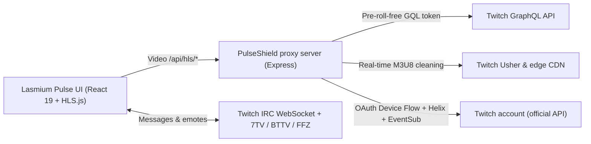

<div align="center">


# LASMIUM *Pulse* `04`

**Modern Twitch viewer • Multi-view up to 9 screens • Ad-free HLS proxy • Hybrid chat • Twitch account**

[](https://github.com/lasme-ephrem/lasmium-pulse/actions)
[](https://react.dev/)
[](https://www.typescriptlang.org/)
[](https://vite.dev/)
[](LICENSE)

<p align="center">
  <em>All your Twitch lives without ad breaks, up to 9 screens at once, in an editorial interface inspired by industrial design (light, dark and OLED themes).</em>
</p>

<p align="center"><a href="README.fr.md">🇫🇷 Version française</a></p>

</div>

---

Lasmium Pulse runs on your own machine (desktop app, Docker, or from the sources). It is **not affiliated with Twitch**. Filtering ads goes against Twitch's terms of service: use it at your own risk, and subscribe to the streamers you want to support.

##  Highlights

| Feature | Description |
| :--- | :--- |
|  **PulseShield™ ad-free HLS** | Local Node.js proxy that intercepts the `.m3u8` manifests from `usher.ttvnw.net`, requests pre-roll-free tokens and strips the stitched ad segments (`stitched-ad`) in real time. |
|  **Multi-view up to 9 screens** | **1 to 9 streams at once** (4 by default, adjustable) with 5 layouts: **Grid**, **Spotlight** (main + column), **Theater** (main + strip), **Columns** and **Studio/Cinema**. Screens reorder by **drag and drop** (mouse or keyboard); a Twitch link can be dropped on the grid. |
|  **Smart Audio Solo** | Click any screen to hear it and mute the others instantly. The volume is **remembered per channel**. |
|  **Full player** | **Quality cap** on secondary screens (720p by default, saves bandwidth), **audio-only** mode, **technical statistics**, PNG **screenshot**, **rewind** inside the live (2 min kept in memory, adjustable) with a **per-screen offset** and an **Align** button to see the same moment on every angle, **local clip** of the last seconds (raw file right away, or MP4 remuxed by ffmpeg.wasm in the browser), always-on-top **floating window** (Chrome/Edge/desktop app). |
|  **Hybrid chat (Fast & Official)** | **Fast mode** (virtualized list, up to 1,000 messages per channel) with Twitch + **7TV / BTTV / FFZ** emotes, an **emote picker** and `:` / `@` autocompletion, a search filter, a **Mix** tab merging the chats of every screen, **chat events** (subscriptions, raids, announcements, bits, deleted messages, timeouts and bans), clickable links, **mention alerts** (highlight, optional sound and notification), **filters** (bots, commands, emote-only, muted words and users, your Twitch block list), a **viewer card** (profile, mention, reply, block, **moderation tools** on the channels you moderate), a **viewers** list, a **detachable chat** window and **messages sent with your Twitch account** (threaded replies like on Twitch, your messages highlighted). One click switches to the **official Twitch chat** (iframe). |
|  **Followed channels & recommendations** | Twitch-like sidebar: your **followed channels** that are live (official Twitch sign-in), **live channels** and **recommended categories** based on what you follow, added in one click. |
|  **End of stream detected** | When a stream ends the screen shows **STREAM ENDED** (duration, past broadcasts, close) instead of freezing; an offline channel restarts by itself when the live comes back. |
|  **Live notifications** | In-app toast (and optional browser notification) when a followed channel goes live, with a **Watch** button; a **per-channel bell** to silence some, a notification **history** in the settings, and the **next scheduled stream** under offline channels. |
|  **Twitch real time (EventSub)** | Signed in, the server receives **title and category changes** of the open screens live, the **end of a stream**, **raids** (**Follow the raid** toast) and followed channels going live, within the subscription budget Twitch grants; polling remains as a fallback. |
|  **Presets & resume** | **Save a multi-view** (channels, layout, volumes) and launch it again in one click from the header or the home page; the **session history** offers to resume the latest multi-views. |
|  **Command palette** | `Ctrl+K`: channels (followed, recent, Twitch search) and actions (layouts, Solo, chat, presets, settings…) from one input, keyboard-first. |
|  **Categories & clips** | Browse the most watched **categories** or search one, filter the live directory on it (with "Show more"), and watch the most viewed **clips** of a channel or a category (24h, 7 days, 30 days, all time) inside the app. |
|  **Past broadcasts (VOD)** | Reliable playback through the local relay (the VOD CDN refuses direct browser requests), 0.5× to 2× speed, clickable **chapters** (game changes), a position bar, and the **chat replay synchronized** with the video in the chat panel. Subscriber-only VODs stay out of reach. |
|  **Session & shareable link** | The multi-view survives a refresh and the URL (`?c=channel1,channel2&layout=spotlight`) can be shared as is. |
|  **Bilingual (EN / FR)** | Language detected from the browser (English by default), picker in the header with the choice remembered; numbers, times and Twitch categories follow the language. The directory "Top" and the recommendations follow the interface language by default, or any other stream language (FR, EN, ES, DE…). |
|  **Twitch clips** | **Clip** button on every screen (`X` key): creates a real Twitch clip of the last seconds from your account, then links to Twitch's edit page. |
|  **Unified settings** | One panel (`,` key): language, **system / light / dark / OLED black** theme, accent colour, stream language, chat, notifications, ad blocker, shortcuts, **export / import** of all your data and "About". Everything is remembered, including Solo, chat sync and the chat mode. |
|  **Keyboard shortcuts & live sync** | `1–9`, `M`, `S`, `F`, `L`, `R`, `X`, `,`… (help with `?`), **customizable keys**, and a resync of every screen to the live edge, with the latency shown. |
|  **Undo & comfort** | Closing a screen can be undone in one click (**Undo** toast), the tab reads `🔴 channel +2 · 46K` with a favicon badge, animated transitions between layouts, a guided tour on first launch, full keyboard navigation (accessible dialogs, visible focus, `prefers-reduced-motion` honoured). |
|  **Themes** | **Broadcast Studio** art direction (*Workshop Paper `#F4F1EA`* in light, *Carbon Console `#0D0D0C`* in dark, **pure black** for OLED), follows the system theme by default, 8 accent colours. |
|  **Universal link reader** | Paste any Twitch link (`twitch.tv/channel`, `twitch.tv/videos/...`, or several links at once) or browse the **Top** of your language and **World** directly. |

---

##  Architecture



---

##  Install & quick start

### Desktop app (Windows, macOS, Linux)

Download the installer of the latest [release](https://github.com/lasme-ephrem/lasmium-pulse-releases/releases): `.exe` (Windows), `.dmg` (macOS), `.AppImage` or `.deb` (Linux). The app embeds the local server, keeps the Twitch session in the system keychain (`safeStorage`) and **updates itself** from GitHub Releases ("Update ready" toast → Restart). Builds are not code-signed yet: Windows SmartScreen and macOS Gatekeeper show a warning on first launch (macOS: right click → Open). On Ubuntu / Debian prefer the `.deb` (menu entry and dock icon installed); an AppImage run as is gets a generic icon until you integrate it (Gear Lever, AppImageLauncher).

Signing in with Twitch needs no configuration: **Sign in with Twitch** in the sidebar, then enter the code on `twitch.tv/activate` (each person with their own account).

### Docker (self-hosting)

```bash
PULSE_SECRET='a-long-random-string' PULSE_PASSWORD='choose-a-password' docker compose up -d
# → http://<machine>:3001
```

`PULSE_SECRET` encrypts the Twitch session on the volume; `PULSE_PASSWORD` is asked by the browser before any access (a must as soon as another machine can reach the server). Twitch sign-in works out of the box (`TWITCH_APP_CLIENT_ID` switches to your own Twitch application). The image is published on `ghcr.io/lasme-ephrem/lasmium-pulse` for every version (`docker.yml`); `docker build -t lasmium-pulse .` builds it from the sources.

### From the sources

#### Requirements
- **Node.js** `>= 22.13` (tested with Node 22 and 24; the library uses Node's built-in SQLite)
- **npm** `>= 10.x`

#### Run in development

```bash
# 1. Clone the repository
git clone https://github.com/lasme-ephrem/lasmium-pulse.git
cd lasmium-pulse

# 2. Install the dependencies
npm install

# 3. (Optional) Configure the ports, the session key, your own Twitch application…
cp .env.example .env

# 4. Start the ad-free proxy (port 3001) and the web client (port 5173) together
#    (npm run build && npm start: one production server on http://127.0.0.1:3001)
npm run dev
```

Then open **[http://localhost:5173](http://localhost:5173)**.

### Twitch sign-in (followed channels, chat, clips, notifications)

Your followed channels are only available with your account's consent. Lasmium Pulse uses Twitch's official **Device Code Flow** (no password and no secret stored in the app): click **Sign in with Twitch** in the sidebar and enter the code shown on `twitch.tv/activate`. Nothing to configure: the app ships the public Client ID of the project's Twitch application (an application identifier, not a secret), and each person signs in with their own account.

To use **your own Twitch application** instead (optional):

1. Create an application on **[dev.twitch.tv/console/apps/create](https://dev.twitch.tv/console/apps/create)**: redirect URL `http://localhost`, category *Application Integration*, **client type: Public**.
2. Put its **Client ID** in `.env`: `TWITCH_APP_CLIENT_ID=...` (desktop app: the path of the `.env` file is shown in Settings → About).
3. Restart the application.

Permissions requested: `user:read:follows` (followed channels), `user:write:chat` (write from the fast chat), `clips:edit` (create clips), `user:read:emotes` (your emotes in the picker), `user:read:blocked_users` / `user:manage:blocked_users` (Twitch block list), `user:read:moderated_channels`, `moderator:manage:chat_messages`, `moderator:manage:banned_users` and `moderator:read:chatters` (moderation tools and viewers list, **only** on the channels you moderate). A session opened before a permission was added asks you to sign in once more (**Allow chatting** in the chat, on the first **Clip** click, or from a viewer card); the app never uses these permissions without an explicit action from you.

The token is kept only by the local server in `server/data/auth.json` (git-ignored), **encrypted** as soon as `PULSE_SECRET` is set in `.env` (otherwise a warning is logged at startup). Everything else works without a `.env` file.

### Several copies side by side

`PULSE_SERVER_PORT` and `PULSE_CLIENT_PORT` in `.env` let you run, for instance, a worktree on `3002` / `5174` next to the main checkout.

### Environment variables

| Variable | Role | Default |
| :--- | :--- | :--- |
| `TWITCH_APP_CLIENT_ID` | Client ID of a "Public" Twitch application to use instead of the one shipped with the app. | *(the project's Client ID)* |
| `PULSE_SERVER_PORT` / `PULSE_CLIENT_PORT` | Ports of the proxy and of the Vite dev client. | `3001` / `5173` |
| `PULSE_SECRET` | Key (16+ characters) that encrypts the Twitch session on disk. | *(empty: stored in clear)* |
| `PULSE_PASSWORD` | HTTP password (8+ characters) asked before any access. | *(none)* |
| `PULSE_SENTRY_DSN` | Sentry DSN for anonymous error reports; they stay off until the switch in the settings is turned on. | *(none)* |
| `PULSE_ALLOW_LAN` | `1` to accept other machines (Docker, home server). | `0`: listens on `127.0.0.1` only |
| `PULSE_ALLOWED_HOSTS` | Extra host names the app may be reached by (e.g. `pulse.local`). | *(empty)* |
| `PULSE_DATA_DIR` | Data folder (session, statistics, SQLite library). | `server/data` |
| `PULSE_LOG_LEVEL` | `fatal` … `trace`, `silent`. | `info` |

The configuration is validated at startup (`server/env.ts`, `zod` schema): an invalid value stops the server with an explicit message.

---

##  Distribution

- **Desktop**: `npm run desktop` launches the Electron shell on the built app (with npm ≥ 11.6, allow Electron's install script first: `npm approve-scripts electron`); `npm run desktop:dist` (or `:win`, `:mac`, `:linux`) produces the packages in `release/` (`electron-builder.yml`). The `release.yml` workflow builds the three systems for every `vX.Y.Z` tag created by release-please and attaches the files to the GitHub Release read by `electron-updater`.
- **Docker**: multi-stage `Dockerfile` (Node 22 slim, final image without dev dependencies, non-root user, `/data` volume, health check), `compose.yml`, publication on GHCR (`docker.yml`).
- **Installable web app (PWA)**: the built client installs from the browser (manifest and icons generated by `vite-plugin-pwa`); only the app shell is cached, never the API nor the video. On a phone the layout goes vertical: stacked screens, chat drawer under them.
- **Manifests**: `packaging/winget/` and `packaging/homebrew/` are ready to submit once the first release is published; `npx lasmium-pulse` is prepared by the `bin` field (npm publication to enable).
- **End-to-end tests**: `npm run test:e2e` (Playwright, stubbed local API), run in CI.
- **Error reports**: Sentry on the client and the server, **off by default**, enabled in Settings → Data when `PULSE_SENTRY_DSN` is set; no identifier, token or channel name is ever sent.

##  Local server security

The server serves one person, on their machine. Three guards keep other sites and other machines away from your Twitch session:

- **Loopback only**: `127.0.0.1` by default; opening to the network is an explicit choice (`PULSE_ALLOW_LAN=1`, with `PULSE_PASSWORD`).
- **`Host` and `Origin` checks**: a malicious page pointing at `localhost` (DNS rebinding) or sending a `POST` from another site is refused (`403`).
- **Per-launch session token**: every request that changes something (chat, clips, settings) must carry the `X-Pulse-Token` header, which a form on another site cannot send. The client fetches it from `GET /api/session`.

On top of that: per-route rate limiting, timeouts and a cap on concurrent requests to Twitch, security headers (`helmet`, strict **CSP** in production, bundled fonts), sandboxed Twitch iframes, and validation of every third-party URL the proxy relays. See [SECURITY.md](SECURITY.md).

---

##  Available commands

| Command | Action |
| :--- | :--- |
| `npm run dev` | Runs the proxy server (`http://localhost:3001`) and the Vite client (`http://localhost:5173`) together. |
| `npm run server` | Starts only the Express ad-free proxy (`server/index.ts`, run with `tsx`). |
| `npm run client` | Starts only the Vite frontend dev server. |
| `npm run build` | Type-checks (`tsc -b`), compiles the server into `dist-server/` and builds the production bundle into `dist/`. |
| `npm start` | Production mode: the compiled server serves the API **and** the `dist/` build on one port (`http://localhost:3001`). |
| `npm run build:electron` | Compiles the desktop shell into `dist-electron/`. |
| `npm run desktop` / `npm run desktop:dist` | Runs the desktop app / builds the installers (`release/`). |
| `npm run lint` | ESLint static analysis (TypeScript + React Hooks rules). |
| `npm test` | Vitest: unit tests (M3U8, IRC, links, filters, i18n), server routes (`supertest`) and components (Testing Library). |
| `npm run test:e2e` | Playwright end-to-end tests on the built client (`PW_CHANNEL=chrome` uses your installed Chrome). |
| `npm run knip` | Dead code detection (unused exports, files and dependencies). |
| `npm run check` | Lint + tests + builds + knip, like the CI. A `husky` hook runs ESLint on the changed files at every commit. |
| `npm run preview` | Previews the production build locally. |

---

##  Project structure

```text
lasmium-pulse/
├── .github/
│   ├── workflows/ci.yml       # CI: lint, tests, build (client, server, Electron), knip, audit, Playwright
│   ├── workflows/release-please.yml # Changelog and versions from the conventional commits
│   ├── workflows/release.yml  # Windows / macOS / Linux desktop packages attached to the release
│   ├── workflows/docker.yml   # Self-hosting image published on GHCR
│   ├── ISSUE_TEMPLATE/, PULL_REQUEST_TEMPLATE.md
│   └── dependabot.yml         # Weekly dependency updates
├── electron/
│   ├── main.ts                # Desktop shell: embedded server, window, safeStorage keychain, updates, tray
│   └── preload.cts            # Minimal bridge exposed to the page (version, external links, updates)
├── e2e/                       # Playwright tests of the built client (stubbed API)
├── packaging/                 # winget and Homebrew manifests ready to submit
├── Dockerfile, compose.yml    # Self-hosted image and deployment
├── electron-builder.yml       # NSIS, DMG, AppImage, deb targets and GitHub publishing
├── playwright.config.ts
├── LICENSE                    # AGPL-3.0
├── CONTRIBUTING.md, SECURITY.md, README.fr.md
├── .env.example               # Ports, encryption key, own Twitch Client ID… (copy to .env)
├── docs/                      # In French
│   ├── ARCHITECTURE.md        # Detailed technical notes (HLS proxy, M3U8, IRC, EventSub, VOD, distribution)
│   └── GUIDE_UTILISATEUR.md   # Complete user guide
├── public/
│   ├── favicon.svg            # Full-bleed vector emblem
│   └── pwa-*.png              # PWA / Apple touch icons rendered from the favicon
├── server/                    # Express server in TypeScript (tsx in dev, tsc → dist-server/)
│   ├── index.ts               # CLI entry (starts the server, logs the configuration)
│   ├── app.ts                 # Application factory: middlewares, routes, dist/ build
│   ├── routes/                # One file per domain: hls, discovery, account, chat, events, vod, adblock, emotes, library, telemetry, health
│   ├── eventsub.ts            # Twitch EventSub (WebSocket): subscriptions of the open screens and followed channels
│   ├── security.ts            # Host / Origin / session token / password guards, rate limiting
│   ├── env.ts                 # .env validated with zod (ports, secret, LAN, data folder, Client ID)
│   ├── http.ts                # fetch to Twitch with timeouts and bounded concurrency
│   ├── twitch.ts              # GQL, playback tokens, Usher, stream mapping
│   ├── adblock.ts             # Blocker state and statistics, backup streams
│   ├── hls.ts                 # Pure M3U8 filtering / rewriting functions (+ hls.test.ts)
│   ├── auth.ts                # Twitch sign-in (Device Code Flow), Helix, chat, clips, emotes, moderation, blocks, schedule
│   ├── secrets.ts             # AES-256-GCM encryption of the session (PULSE_SECRET / OS keychain)
│   ├── db.ts                  # SQLite library (presets, history, notifications, preferences, server settings)
│   ├── emotes.ts              # 7TV + BTTV + FFZ emotes with cache and URL validation
│   ├── storage.ts             # JSON persistence in the data folder (git-ignored)
│   ├── logger.ts              # pino logs (tokens redacted)
│   ├── telemetry.ts           # Sentry error reports, off by default
│   └── app.test.ts            # Route and guard tests (supertest)
├── shared/api.ts              # Contracts of the local API, shared by client and server
├── src/
│   ├── components/
│   │   ├── AccountModal.tsx   # Twitch activation code / setup guide
│   │   ├── ChannelSidebar.tsx # Followed channels, live channels & recommended categories
│   │   ├── ChatComposer.tsx   # Message input, @ and : autocompletion, emote picker
│   │   ├── ChatPanel.tsx      # Hybrid chat: tabs, Mix, filters, mention alerts, Twitch iframe, VOD replay
│   │   ├── ChatPopout.tsx     # The chat alone in its own window (?popout=chat)
│   │   ├── CommandPalette.tsx # Ctrl+K palette: channels and actions
│   │   ├── PresetsMenu.tsx    # Saved multi-views (header)
│   │   ├── discovery/
│   │   │   ├── CategoryBrowser.tsx # Most watched categories and search
│   │   │   └── ClipsBrowser.tsx    # Most viewed clips of a channel or a category, embedded player
│   │   ├── chat/
│   │   │   ├── ChatMessageList.tsx # Virtualized list (@tanstack/react-virtual) with auto-scroll
│   │   │   ├── ChatMessageRow.tsx  # One row: emotes, links, badges, bits, deleted messages, events
│   │   │   ├── EmotePicker.tsx     # Emote picker (recent, Twitch, 7TV / BTTV / FFZ)
│   │   │   ├── UserCard.tsx        # Viewer card: profile, actions, blocking, moderation
│   │   │   └── ChatViewers.tsx     # Recent chatters and Twitch list (moderators)
│   │   ├── DiscoveryView.tsx  # Editorial home, link bar, resume, live directory, categories, clips
│   │   ├── ErrorBoundary.tsx  # Safety net: an error takes down one screen, never the app
│   │   ├── Modal.tsx          # Accessible dialog (focus trapped and restored, Escape, aria-modal)
│   │   ├── SettingsModal.tsx  # Tabbed settings (general, playback, chat, notifications, ad blocker, shortcuts, data, about)
│   │   ├── AdBlockPanel.tsx   # Blocker dashboard and settings (ad blocker tab)
│   │   ├── OnboardingTour.tsx # First-launch guided tour
│   │   ├── Header.tsx         # Command bar, instant search, layouts, presets, palette, theme toggle
│   │   ├── MultiStreamStage.tsx # Multi-view grid (layouts, drag and drop, floating window)
│   │   ├── PulseLogo.tsx      # Brand component
│   │   ├── ShortcutsModal.tsx # Keyboard shortcuts help
│   │   ├── StatsOverlay.tsx   # "Technical statistics" panel of a screen
│   │   └── StreamTile.tsx     # HLS.js player: quality, latency, rewind, local clip, stats, VOD controls, end of stream
│   ├── i18n/
│   │   ├── fr.ts / en.ts      # Dictionaries (fr is the reference, en is typed against it)
│   │   ├── core.ts            # Languages, detection, context, useI18n, translated errors
│   │   └── I18nProvider.tsx   # React provider (language, Intl formats, <html lang>)
│   ├── settings/
│   │   ├── schema.ts          # zod schema of every setting, defaults, shortcuts
│   │   ├── storage.ts         # localStorage load / save, migration of the legacy keys
│   │   ├── SettingsProvider.tsx / context.ts # React context (settings, update, replace, reset)
│   │   ├── theme.ts           # Resolved theme (system, OLED) and accent colour on <html>
│   │   └── backup.ts          # JSON export / import (settings, session, server library)
│   ├── hooks/
│   │   ├── useChatEmotes.ts        # Twitch emotes (Helix) or seen in chat + third-party, recents
│   │   ├── useDocumentPip.ts       # Floating window (Document Picture-in-Picture)
│   │   ├── useDocumentTitle.ts     # Dynamic tab title and favicon badge
│   │   ├── useIrcChat.ts           # Anonymous IRC connection, JOIN/PART, per-channel history, events
│   │   ├── useLibrary.ts           # Presets and session history (server library)
│   │   ├── useServerEvents.ts      # SSE stream of server events (EventSub)
│   │   ├── useVodChatReplay.ts     # Chat of a past broadcast synchronized with the video
│   │   ├── useKeyboardShortcuts.ts # Global keyboard shortcuts
│   │   └── useTwitchAccount.ts     # Twitch account, followed channels & live notifications
│   ├── types/twitch.ts        # TypeScript interfaces
│   ├── utils/
│   │   ├── twitchUrlParser.ts # Twitch URL parser
│   │   ├── api.ts             # Local API client (language, session token)
│   │   ├── segmentBuffer.ts   # Ring of the last segments of a live (local clip, TS or fMP4)
│   │   ├── clipConvert.ts     # MP4 remux with ffmpeg.wasm, loaded on demand
│   │   ├── ircParser.ts       # IRCv3 parsing: messages, USERNOTICE, CLEARCHAT, CLEARMSG, NOTICE
│   │   ├── chatFilters.ts     # Chat filters (bots, commands, emote-only, words, users) and mentions
│   │   ├── links.ts           # Safe link detection (http/https only)
│   │   ├── popout.ts          # Detached chat window
│   │   ├── vodChat.ts         # Past broadcast comments → chat messages
│   │   └── session.ts         # Screens, local persistence & shareable link
│   ├── desktop.ts             # Bridge to the desktop app (absent in a browser)
│   ├── telemetry.ts           # Client-side error reports, loaded on demand
│   ├── App.tsx                # Multi-view, audio solo & theme orchestration
│   └── index.css              # Light / dark design system & animations
└── package.json
```

---

##  Further documentation

-  **[User guide](./docs/GUIDE_UTILISATEUR.md)** (French) — multi-view, audio solo, chat, Twitch account, past broadcasts, installation.
-  **[Technical architecture](./docs/ARCHITECTURE.md)** (French) — M3U8 filtering, ad-free proxy, chat, EventSub, VOD, distribution.
-  **[Contributing](./CONTRIBUTING.md)** ·  **[Security](./SECURITY.md)** ·  **[AGPL-3.0 licence](./LICENSE)**
