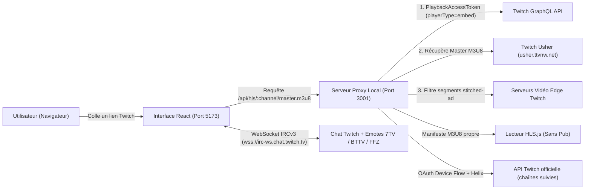

# Architecture Technique — Lasmium Pulse

**Lasmium Pulse** repose sur une architecture hybride combinant une interface réactive moderne (**React 19 + TypeScript + Vite + Tailwind CSS v4**) et un serveur proxy local (**Node.js + Express 5**) chargé de l'acquisition des flux HLS Twitch sans publicité.

---

## 1. Vue d'ensemble du flux de données

Le serveur est écrit en **TypeScript** (`tsx` en développement, `tsc` vers `dist-server/` en production) et partage ses contrats d'API avec le client via `shared/api.ts`. Modules : `app.ts` (fabrique Express, middlewares, service du build), `routes/*` (une route par domaine), `security.ts` (gardes), `env.ts` (configuration validée par `zod`), `http.ts` (appels sortants bornés), `twitch.ts` (GQL / Usher), `adblock.ts`, `hls.ts` (fonctions pures M3U8, testées), `auth.ts` (compte Twitch), `secrets.ts`, `db.ts` (SQLite), `emotes.ts`, `storage.ts`, `logger.ts` (pino).

---

## 2. Moteur Anti-Publicité HLS (`server/routes/hls.ts`, `server/adblock.ts`)

Twitch insère ses publicités directement dans les manifestes de transport vidéo (`.m3u8` Server-Side Ad Insertion). Pour éviter à la fois les coupures publicitaires et l'écran violet de blocage, **Lasmium Pulse** applique une stratégie en **3 couches** :

1. **Couche 1 — Jeton GraphQL optimisé (`PlaybackAccessToken_Template`)** :
   - Lorsqu'un flux est demandé sur `/api/hls/:channel/master.m3u8`, le proxy interroge `https://gql.twitch.tv/gql` avec le profil `playerType: "embed"` (ou `"picture-by-picture"`), exempt de la majorité des pré-rolls publicitaires.
   - Les URLs des sous-playlists de qualité (`1080p60`, `720p60`, `480p`, etc.) sont réécrites vers `/api/hls/variant.m3u8`.

2. **Couche 2 — Bascule sur flux de secours (`getBackupVariantM3u8`)** :
   - Si un manifeste de variante contient des marqueurs publicitaires (`stitched-ad`, `X-TV-TWITCH-AD`, `twitch-ad-quartiles`, `live-ad`), le proxy tente immédiatement de récupérer une variante propre générée via un jeton secondaire (`picture-by-picture`).

3. **Couche 3 — Nettoyage en temps réel du manifeste M3U8 (`filterVariantPlaylist`)** :
   - Suppression des balises `#EXT-X-DATERANGE` publicitaires et filtrage des segments `#EXTINF` marqués `Amazon` ou `stitched-ad`.
   - Les URLs relatives des segments `.ts` / `.mp4` sont converties en URLs absolues vers le CDN Twitch afin que le navigateur télécharge les fragments vidéo directement à pleine vitesse sans saturer le serveur Node.js local.

**Stratégies** (`POST /api/adblock/config`) :

| Stratégie | Couche 2 (flux de secours) | Couche 3 (purge) |
| :--- | :--- | :--- |
| `multi-layer` | ✅ | Purge tant qu'il reste au moins un segment propre |
| `embed-token` | ❌ | Purge tant qu'il reste au moins un segment propre |
| `aggressive-strip` | ✅ | Purge tout ; si plus rien n'est propre, rejoue la dernière playlist sans pub (image figée plutôt que pub) |

**Sécurité** : `/api/hls/variant.m3u8` n'accepte que des URLs `https` vers les CDN Twitch (`*.ttvnw.net`, `*.cloudfront.net`, …), ce qui empêche le proxy de servir de relais ouvert.

**Persistance** : la configuration et les statistiques sont écrites (avec un délai de 2 s) dans `<données>/adblock-stats.json` ; `POST /api/adblock/reset` les remet à zéro.

**Lecteur** (`StreamTile.tsx`) : `hls.js` (≈ 580 Ko) est importé dynamiquement au premier écran lu ; le bundle initial reste sous 330 Ko.

---

## 3. Système Multi-Vue & Audio Intelligent (`src/components/MultiStreamStage.tsx` & `StreamTile.tsx`)

- **Capacité** : 9 flux au plus (`MAX_STREAMS`, cap dur de `session.ts`), limite effective `settings.playback.maxStreams` (4 par défaut) ; un avertissement s'affiche au-delà de 4.
- **Modes de disposition** :
  - `grid` : grille automatique (`1×1`, `1×2`, `2×2`, `3×2`, `3×3`) ; une baie libre propose l'ajout rapide.
  - `spotlight` (Focus) : 1 grand écran principal à gauche + les autres empilés à droite ; `theater` : principal en haut + bandeau ; `columns` : tous côte à côte.
  - `cinema` : Maximisation de l'espace vidéo et masquage automatique du panneau latéral.
- **Un seul conteneur** : toutes les dispositions sont la même liste de cellules (clés stables) dans une grille CSS dont seuls les styles changent (`layoutStyles`) ; changer de disposition ou déplacer un écran ne démonte donc jamais un lecteur (aucun rechargement).
- **Réorganisation** : `@dnd-kit` (`DndContext` + `SortableContext`, capteurs pointeur et clavier) ; le badge `CH.0X` est la poignée. Dépôt HTML5 d'un lien ou d'un texte sur la scène → `parseTwitchInput`.
- **Qualité par écran** : `hls.autoLevelCapping` sur les écrans ni sélectionnés ni principaux, selon `secondaryQualityCap`, tant que la qualité est sur « auto ».
- **Audio seul** : `GET /api/hls/:channel/master.m3u8?audio=1` renvoie un master réduit à la variante `audio_only` (`audioOnlyMaster`) ; hls.js retirant les niveaux audio quand des niveaux vidéo existent, c'est le seul moyen fiable. Le lecteur recharge la source.
- **Retour arrière / décalage** : `backBufferLength` et `maxBufferLength` = `rewindSeconds` (la lecture continue à charger le direct pendant qu'on est en arrière). `seekBehind(s)` se place à `liveSyncPosition − s` et neutralise à la volée `liveMaxLatencyDuration` et `maxLiveSyncPlaybackRate` (lus par hls.js à l'exécution) pour que le lecteur ne rattrape pas le direct. Les décalages vivent dans `App` (`liveOffsets`), ce qui permet **Aligner**.
- **Clip local** (`segmentBuffer.ts`) : anneau borné en mémoire des segments bruts reçus par `FRAG_LOADED` (copiés, hls.js transfère le tampon à son worker). Twitch sert soit du MPEG-TS (concaténation directe), soit des fragments fMP4/CMAF : l'init segment de chaque niveau (`frag.initSegment.data`) est conservé et un clip ne couvre qu'un seul niveau. Les fragments fMP4 portent le temps absolu du live : `fmp4.ts` réécrit les boîtes `tfdt` (et `sidx`) à partir des `timescale` lus dans l'init pour que le fichier démarre à 0:00 (vérifié avec ffprobe). Les flux MPEG-TS gardent leurs PTS d'origine, ce que les lecteurs gèrent normalement. Format brut immédiat, ou remux `-c copy` en MP4 standard par `ffmpeg.wasm` (`clipConvert.ts`, core chargé à la demande via `?url`, CSP `wasm-unsafe-eval`).
- **Capture** : `canvas.drawImage(video)` (le flux vient de MSE : pas de canvas « tainted ») → PNG téléchargé et copié (`ClipboardItem`).
- **Fenêtre flottante** (`useDocumentPip.ts`) : Document Picture-in-Picture ; feuilles de style, `data-theme` et variables d'accent copiées dans la fenêtre, tuile rendue par `createPortal` (le lecteur se recharge en 2–3 s), placeholder « Ramener ici » dans la grille.
- **Volume par chaîne** : `PUT /api/library/channels/:login` (débounce 800 ms) ; appliqué à l'ouverture d'une chaîne.
- **Prefetch** (`adblockState.prefetch`, désactivé) : `#EXT-X-TWITCH-PREFETCH` converti en segments (`filterVariantPlaylist`, jamais pendant une pub). Mesuré sur le même live : sans, latence stable à 4,0 s ; avec, 2,6–6,0 s et plus d'images perdues. Gardé en option expérimentale.
- **Audio Solo Intelligent** :
  - En mode Multi-Vue, cliquer sur une vidéo (ou la passer en Focus) active automatiquement son canal audio et coupe les autres écrans pour éviter toute superposition sonore. Réactiver Solo l'applique immédiatement à l'écran sélectionné.
- **Latence** (`StreamTile.tsx`, config hls.js) : cible en secondes (`liveSyncDuration: 4`, `liveMaxLatencyDuration: 12`) et non en segments, car Twitch annonce `TARGETDURATION:6` pour des segments de 2 s (« 3 segments » = 18 s de retard). `maxLiveSyncPlaybackRate: 1.1` rattrape le retard en accélérant légèrement la lecture.
- **Clips** : `POST /api/clips` → Helix `POST /clips` avec le jeton de l'utilisateur (scope `clips:edit`, exposé par `canClip`). Twitch capture les dernières secondes et renvoie `edit_url`, proposée dans un toast. Les refus de Twitch (chaîne hors ligne, clips désactivés…) sont renvoyés tels quels.

---

## 4. Chat Hybride (`src/components/ChatPanel.tsx`)

- **Mode Rapide (IRC WebSocket natif, `src/hooks/useIrcChat.ts`)** :
  - Connexion directe à `wss://irc-ws.chat.twitch.tv:443` en mode lecture anonyme (`justinfanXXXXX`) sans cookies tiers, avec reconnexion automatique (délai exponentiel de 1 s à 30 s, et sur commande `RECONNECT` de Twitch). `JOIN`/`PART` suivent les écrans ; les messages d'une chaîne fermée sont oubliés.
  - **Analyseur IRCv3** (`src/utils/ircParser.ts`, `parseIrcLine`) : `PRIVMSG` (tags `badges`, `color`, `display-name`, `emotes`, `bits`, `reply-parent-*` déséchappés), `USERNOTICE` (sub, resub, cadeaux, raid, annonce → ligne système avec `system-msg`), `NOTICE` (mode lent, etc.), `CLEARCHAT` (timeout / ban / vidage → messages marqués `deleted` + ligne de modération) et `CLEARMSG` (message supprimé). Chaque commande est couverte par `ircParser.test.ts`.
  - Les lignes reçues sont mises en file et appliquées une fois par image (`requestAnimationFrame`) : un seul `setState` quel que soit le débit. L'historique par chaîne est réglable (100 à 1 000 messages) ; l'onglet **Mix** fusionne par horodatage les chaînes ouvertes.
  - **Liste virtualisée** (`src/components/chat/ChatMessageList.tsx`, `@tanstack/react-virtual`) : seules les lignes visibles sont rendues, mesurées dynamiquement ; collée au bas tant que le viewer ne remonte pas (pause automatique à 90 px du bas). Chaque ligne (`ChatMessageRow`, mémoïsée) rend emotes Twitch par position, emotes tierces par mot, **liens** (`src/utils/links.ts` : `http(s)` ou domaine nu, tout autre schéma refusé ; `target=_blank rel="noopener noreferrer"`), mentions, bits, messages supprimés (cliquables pour les révéler) et lignes système.
  - Emotes tierces par chaîne via `/api/emotes/:channelId` : **7TV**, **BTTV** et **FFZ** (globales + chaîne). En cas de conflit de nom : chaîne > global, puis 7TV > BTTV > FFZ. Seules les URL `https` des CDN de ces trois fournisseurs sont acceptées.
  - **Filtres** (`src/utils/chatFilters.ts`) : bots connus, commandes `!`, messages d'emotes seules, mots masqués, pseudos masqués localement et liste de blocage Twitch (`GET /api/me/blocks`, Helix `/users/blocks`). Les lignes système et les messages du viewer ne sont jamais filtrés.
  - **Mentions** (`mentionsViewer`, mot entier insensible à la casse) : surlignage, son synthétisé par WebAudio (`src/utils/mentionSound.ts`, aucun fichier audio) et notification du navigateur si l'onglet est caché, selon les réglages.
  - **Historique tiers** (opt-in, `settings.chat.recentMessages`) : `GET /api/chat/recent/:login` relaie `recent-messages.robotty.de` (50 lignes IRC brutes, analysées par le même `parseIrcLine`, dédupliquées par `id`).
- **Écriture depuis le mode Rapide** (`src/components/ChatComposer.tsx`) : `POST /api/chat/send` → Helix `POST /chat/messages` avec le jeton de l'utilisateur (scope `user:write:chat`), côté serveur uniquement. Aucun écho local : le message revient par la connexion IRC anonyme comme les autres. Les refus de Twitch (`drop_reason`) sont renvoyés tels quels à l'interface.
  - **Réponses** : `replyParentMessageId` (tag IRC `id` du message visé) → `reply_parent_message_id` Helix ; le texte est préfixé par `@auteur` comme le fait le client Twitch, et part vers la chaîne du message visé (utile en Mix).
  - **Autocomplétion** : `@` sur les auteurs récents de la ou des chaînes affichées, `:` (deux lettres minimum) sur les emotes ; `EmotePicker` (récentes en `localStorage`, Twitch, tierces). Les emotes Twitch viennent de `GET /api/chat/emotes/:login` (Helix `/chat/emotes/global`, `/chat/emotes`, `/chat/emotes/user` avec `user:read:emotes`, cache serveur 10 min) quand le viewer est connecté, sinon des emotes déjà vues dans le chat (`useChatEmotes`).
  - Seuls les messages du compte connecté (`ownLogin`) sont surlignés.
- **Fiche viewer** (`src/components/chat/UserCard.tsx`) : profil via `/api/channel/:login` (avatar, `createdAt`, followers), mention / réponse / copie, masquage local (`settings.chat.filters.blockedUsers`), blocage Twitch (`PUT`/`DELETE /api/me/blocks/:login`). Les **outils de modération** (`POST /api/moderation/delete|ban|unban` → Helix `/moderation/chat`, `/moderation/bans`) n'apparaissent que si le viewer modère la chaîne (`GET /api/me/moderated`, Helix `/moderation/channels`, cache 5 min) ou en est le diffuseur ; chaque action demande une confirmation et le serveur vérifie l'autorisation (`requireGrant`, codes `missing_*_scope`). Aucune action n'est jamais déclenchée sans clic explicite.
- **Viewers** (`ChatViewers.tsx`) : auteurs récents (mémoire du chat) et, pour un modérateur, la liste complète Helix `/chat/chatters` (`moderator:read:chatters`, rafraîchie toutes les 60 s).
- **Chat détaché** (`src/components/ChatPopout.tsx`, `src/utils/popout.ts`) : `?popout=chat&c=login1,login2` rend le `ChatPanel` seul (même `SettingsProvider`, thème appliqué) ; `window.open` en fenêtre `popup`.
- **Autorisations** (`server/auth.ts`, `GRANT_SCOPES`) : toutes les permissions sont demandées en une fois à la connexion ; `AuthStatus.grants` (`chat`, `clip`, `emotes`, `moderation`, `chatters`, `blocks`) indique celles que la session possède réellement, et l'interface propose une reconnexion quand il en manque une.
- **Mode Officiel (Iframe Twitch)** :
  - Permet de basculer en 1 clic sur l'iframe officielle Twitch (`https://www.twitch.tv/embed/:channel/chat`), qui utilise la session twitch.tv du navigateur, en synchronisant automatiquement le thème Clair ou Sombre.

---

## 5. Système de Design & Thèmes Clair / Sombre (`src/index.css`)

- Direction artistique inspirée du design industriel (*Braun / Dieter Rams*, *Teenage Engineering*) et du style typographique international suisse.
- **Mode Clair (`[data-theme="light"]`)** : Fond papier pierre chaud (`#F4F1EA`), surfaces aluminium (`#EAE5DC`), encre carbone (`#141413`) et vermillon (`#FF3B1D`).
- **Mode Sombre (`[data-theme="dark"]`)** : Carbone mat (`#0D0D0C`), platine graphite (`#141413`), craie (`#F4F1EA`) et vert cathodique (`#1EC988`).

---

## 6. Compte Twitch, chaînes suivies & recommandations

- **Connexion** (`server/auth.ts`) : *Device Code Flow* OAuth pour client public (Client ID public de l'application Twitch du projet embarqué par défaut dans `server/env.ts`, remplaçable par la variable `TWITCH_APP_CLIENT_ID` ; scopes `user:read:follows`, `user:write:chat`, `clips:edit`, `user:read:emotes`, `user:read:blocked_users`, `user:manage:blocked_users`, `user:read:moderated_channels`, `moderator:manage:chat_messages`, `moderator:manage:banned_users`, `moderator:read:chatters` ; `AuthStatus.grants` indique ceux que la session possède, voir §4). `POST /api/auth/device/start` renvoie un code à valider sur `twitch.tv/activate` ; le client interroge `POST /api/auth/device/poll` toutes les 5 s. Les jetons (accès + rafraîchissement) restent côté serveur dans `<données>/auth.json`, chiffrés par `secrets.ts` (voir §9), et sont renouvelés automatiquement en cas d'expiration ou de réponse 401.
- **Chaînes suivies** : `GET /api/me/followed` combine Helix `/streams/followed` (lives, triés par spectateurs) et `/channels/followed` (hors ligne), avec avatars via `/users`. Cache de 45 s ; le client actualise toutes les 60 s et détecte les nouveaux lives pour les notifications.
- **Recommandations** : `GET /api/recommendations` part des catégories jouées par vos chaînes suivies en direct, complétées par les catégories les plus regardées. Une seule requête GraphQL avec alias récupère, pour chaque catégorie, les spectateurs, les genres (en français) et les meilleurs streams, puis les chaînes déjà suivies sont exclues. Cache de 60 s.
- `GET /api/top-streams?game=<nom>` filtre le répertoire sur une catégorie ; `limit` jusqu'à 60 (les curseurs de pagination du GQL public exigent le jeton d'intégrité de Twitch, donc « Afficher plus » demande une première page plus grande) et `hasMore` indique qu'il en reste.
- **Planning** : `GET /api/schedule?logins=a,b` (jusqu'à 20) → Helix `/schedule` par chaîne, premier segment non annulé à venir, cache 10 min ; la barre latérale l'affiche sous les chaînes suivies hors ligne.
- **Notifications par chaîne** : `channel_prefs.notify === false` (`PUT /api/library/channels/:login`) coupe le toast et la notification du navigateur pour une chaîne ; chaque notification émise est consignée dans `notification_history` (`POST /api/library/notifications`), consultable et effaçable dans Réglages → Notifications.

## 7. Session, partage & qualité

- **Session** (`src/utils/session.ts`) : les écrans et la disposition sont sauvegardés dans `localStorage` et reflétés dans l'URL (`?c=a,b,vod-123&layout=spotlight`). Au chargement, l'URL est prioritaire sur la sauvegarde locale.
- **Synchronisation du direct** : chaque lecteur affiche `hls.latency`. Une resynchronisation globale positionne chaque vidéo sur `hls.liveSyncPosition`.
- **Fin de live** (`StreamTile.tsx`) : le statut vient de `/api/channel/:login` (toutes les 30 s, toutes les 8 s quand le lecteur est « suspect » : erreur réseau HLS ou vidéo sans progression pendant ~10 s). Le lecteur HLS n'est attaché que si la chaîne est en live ; la clé de source inclut l'identifiant de diffusion Twitch, donc un nouveau live recharge automatiquement le lecteur. Un live vu puis terminé déclenche `onStreamEnded` (notification « A TERMINÉ SON LIVE »).
- **Autoplay** : sans interaction, le navigateur refuse `play()` avec le son ; le lecteur repart en muet et rétablit le son au premier `pointerdown`/`keydown` (phase de capture). Le bouton son ignore le clic qui a servi à ce rétablissement pour ne pas recouper aussitôt.
- **Accueil** : le logo affiche l'accueil sans démonter la scène (`hidden`), les lecteurs continuent donc de jouer.
- **Production** : si `dist/` existe, Express sert aussi l'interface (`npm run build && npm start`) avec des en-têtes de cache adaptés (`assets/` immuables, `index.html` toujours revalidé).
- **Toasts** : pile de trois messages au maximum, chacun avec son minuteur ; la fermeture d'un écran propose **Annuler** (l'écran est réinséré à sa position d'origine).
- **Titre d'onglet et favicon** (`useDocumentTitle`) : chaque écran remonte son état live (`onMetadata`) ; le titre suit l'écran sélectionné et un badge dessiné sur un canvas remplace le favicon par le nombre d'écrans en direct.
- **Transitions** (`withViewTransition`) : les changements de disposition, l'ouverture du chat et de la barre latérale passent par `document.startViewTransition` + `flushSync` quand le navigateur le propose, sauf si l'utilisateur ou le système (`prefers-reduced-motion`) refuse les animations.
- **Accessibilité** : `Modal.tsx` (rôle `dialog`, `aria-modal`, focus déplacé à l'ouverture et restauré à la fermeture, Tab cyclique, Échap) sert à toutes les fenêtres ; écrans en `role="region"` nommés, chat en `role="log"`, focus visible global, contrastes du texte atténué relevés au-dessus de 4,5:1 sur les deux thèmes, animations décoratives coupées en `prefers-reduced-motion`.
- **Robustesse** : deux *error boundaries* (`ErrorBoundary.tsx`) — une autour de l'application (écran « Quelque chose a cassé » avec rechargement) et une par écran de la multi-vue (réessayer ou fermer l'écran) — évitent qu'une erreur de rendu ne vide toute la page.
- **Chargement** : la page d'accueil, le chat et les modales sont des modules chargés à la demande (`React.lazy`) ; React a son propre morceau mis en cache longtemps.
- **Qualité** : `npm run check` enchaîne ESLint (TypeScript + React Hooks, côté client et serveur), Vitest (unitaires, routes du serveur avec `supertest` et `fetch` simulé, composants avec Testing Library), le build et `knip` (code mort). TypeScript refuse les variables et paramètres inutilisés. Un hook `husky` + `lint-staged` lance ESLint sur les fichiers modifiés à chaque commit ; la CI GitHub Actions (`ci.yml`) rejoue `check` et `npm audit`, Dependabot propose les mises à jour, et `release-please` tient le changelog et les versions à partir des commits conventionnels.
- **Journaux** : `pino` (lisible en développement, JSON en production, niveau `PULSE_LOG_LEVEL`) ; les champs contenant des jetons sont masqués. `GET /api/health` renvoie la version, l'uptime et la version de Node.

## 8. Internationalisation (`src/i18n/`)

- **Dictionnaires** : `fr.ts` est la référence ; `en.ts` est typé `Messages = typeof fr`, donc une clé manquante casse le build. Les textes paramétrés (pluriels, noms) sont des fonctions (`t.toasts.assigned(name, n)`), sans clés en chaîne de caractères.
- **Détection** (`core.ts`, `detectLanguage`) : choix mémorisé (`localStorage`) > `navigator.languages` (variantes régionales incluses : `fr-CA` → `fr`) > anglais.
- **Provider** (`I18nProvider.tsx`) : expose `t`, `formatCount` / `formatTime` (`Intl`), met à jour `<html lang>` et le titre. La langue est transmise à l'API locale (`Accept-Language`, via `apiFetch`/`getJson`) dès le premier rendu.
- **Serveur** : il ne produit plus de texte affiché. Les erreurs portent un `code` (traduit par `describeError`) et le journal anti-pub stocke des événements bruts (`type`, `segmentsCount`, `enabled`, `strategy`) rendus côté client. Les requêtes GQL suivent la langue de l'interface (catégories, genres) et `lang=FR|EN|…|ALL` filtre les streams par langue de diffusion. Cette langue de streams (`streamLanguage`, liste `STREAM_LANGUAGES`) suit celle de l'interface tant que l'utilisateur n'en a pas choisi une autre (`pulsetv_stream_language_v1`). Seuls les refus de Twitch (`drop_reason`) restent dans la langue de Twitch.
- **Ajouter une langue** : créer `xx.ts` typé `Messages`, l'ajouter à `LANGUAGES` dans `core.ts` (nom natif, locale `Intl`, langue de diffusion Twitch) et au type `Language`.

## 9. Sécurité du serveur local (`server/security.ts`, `server/app.ts`)

Le serveur ne sert qu'une personne, sur sa machine ou son serveur maison. Il est conçu pour qu'un site web ouvert dans le navigateur, ou une autre machine du réseau, ne puisse pas s'en servir.

- **Écoute** : `127.0.0.1` par défaut. `PULSE_ALLOW_LAN=1` écoute sur toutes les interfaces et accepte les hôtes en adresse IP ; `PULSE_ALLOWED_HOSTS` ajoute des noms (reverse proxy).
- **Garde `Host`** : toute requête dont l'hôte n'est ni local, ni autorisé, reçoit `403 forbidden_host`. C'est la parade au *DNS rebinding* (un domaine attaquant résolu vers `127.0.0.1` envoie quand même son propre `Host`).
- **Garde `Origin`** (requêtes non `GET`) : `Sec-Fetch-Site: cross-site` ou une origine étrangère → `403 forbidden_origin`. Il n'y a plus de CORS : en développement le client passe par le proxy de Vite (même origine), en production Express sert le build.
- **Jeton de session** : généré à chaque lancement (`GET /api/session`, lisible uniquement depuis la même origine faute de CORS), exigé dans `X-Pulse-Token` sur toute requête qui modifie quelque chose. `apiFetch` (client) le récupère à la première écriture et le renouvelle si le serveur a redémarré.
- **Limitation de débit** (`express-rate-limit`, en-têtes `RateLimit` standard) : 120/min sur la découverte, 30/min sur le chat, les clips et la connexion.
- **Appels sortants** (`http.ts`) : `AbortSignal.timeout` (10 s) sur chaque requête vers Twitch ou les fournisseurs d'emotes, au plus 8 requêtes simultanées.
- **En-têtes** (`helmet`) : CSP stricte en production (`script-src 'self'`, `connect-src` limité à l'IRC Twitch et aux CDN vidéo, `frame-src` aux iframes Twitch, `media-src blob: data:` pour MSE), `frame-ancestors 'self'`, politique de référent stricte. Les polices sont embarquées (`@fontsource`), donc aucune requête vers Google. Les iframes Twitch (lecteur embed, chat officiel) sont en `sandbox`.
- **Session Twitch au repos** (`secrets.ts`) : AES-256-GCM avec une clé dérivée (`scrypt`) de `PULSE_SECRET`, ou un fournisseur injecté par l'application de bureau (`safeStorage`). Sans clé, fichier en clair avec permissions `0600` et avertissement au démarrage. Un fichier chiffré avec une autre clé est ignoré (session à rouvrir).
- **Entrées** : logins validés (`^[a-z0-9_]{2,25}$`), corps JSON limités à 64 Ko et validés par `zod` sur la bibliothèque, URL de variantes HLS restreintes aux CDN Twitch, URL d'emotes restreintes aux CDN 7TV/BTTV/FFZ.

## 10. Bibliothèque SQLite (`server/db.ts`, `server/routes/library.ts`)

Le SQLite intégré à Node (`node:sqlite`, d'où `engines.node >= 22.13`) stocke dans `<données>/library.sqlite` (mode WAL, migrations par `PRAGMA user_version`) :

| Table | Contenu | Routes |
| :--- | :--- | :--- |
| `presets` | Multi-vues enregistrées (nom, écrans, disposition, dernière utilisation) | `GET/PUT /api/library/presets`, `POST …/:id/use`, `DELETE …/:id` |
| `session_history` | Les 200 dernières sessions (chaînes, disposition) | `GET/POST/DELETE /api/library/history` |
| `notification_history` | Les 500 dernières notifications de live | `GET/POST/DELETE /api/library/notifications` |
| `channel_prefs` | Volume, sourdine et notifications par chaîne | `GET /api/library/channels`, `GET/PUT …/channels/:login` |

Les fichiers JSON (`auth.json`, `adblock-stats.json`) restent gérés par `storage.ts`. Le dossier de données se déplace avec `PULSE_DATA_DIR` (volume Docker, dossier utilisateur de l'application de bureau).

## 11. Réglages (`src/settings/`)

- **Schéma** (`schema.ts`) : un objet `zod` par section (`general`, `playback`, `chat`, `notifications`, `shortcuts`, `onboarding`) avec les valeurs par défaut ; `sanitizeSettings` garde les sections valides et remet les autres à zéro, donc un fichier corrompu ou une ancienne version ne bloque jamais le démarrage.
- **Stockage** (`storage.ts`) : clé `pulsetv_settings_v1`. Au premier chargement sans cette clé, les anciennes clés (`pulsetv_studio_theme_v1`, `pulsetv_language_v1`, `pulsetv_stream_language_v1`, `pulsetv_sidebar_collapsed_v1`, `pulsetv_live_notifications_v1`) sont migrées puis supprimées.
- **Contexte** (`SettingsProvider.tsx`, `context.ts`) : `useSettings()` expose `settings`, `update(patch)` (fusion section par section), `replace` (import) et `reset`. Le fournisseur enveloppe `I18nProvider`, qui lit la langue de l'interface et des streams dans les réglages (`'auto'` suit le navigateur).
- **Thème** (`theme.ts`) : `useResolvedTheme` suit `prefers-color-scheme` pour `system` ; `useApplyTheme` pose `data-theme` (`light`, `dark`, `oled`) et les variables `--accent-signal` / `--accent-signal-soft` sur `<html>`.
- **Raccourcis** : `settings.shortcuts` (action → touche) ; `App` construit la table passée à `useKeyboardShortcuts`, les chiffres 1–9 et Échap restant fixes.
- **Sauvegarde** (`backup.ts`) : export JSON `{ app: 'lasmium-pulse', settings, session, recentChannels, library }` ; l'import valide le fichier, remplace les réglages, écrit la session et les chaînes récentes, renvoie presets et préférences par chaîne au serveur (`PUT /api/library/*`), puis recharge l'application.

## 12. Temps réel Twitch (`server/eventsub.ts`, `server/routes/events.ts`)

- Dès qu'une session Twitch existe, le serveur ouvre une connexion **EventSub WebSocket** (`wss://eventsub.wss.twitch.tv/ws`, API `WebSocket` native de Node 22) : `session_welcome` → abonnements, `session_keepalive` (reconnexion si manqué), `session_reconnect` (bascule sur la nouvelle URL sans perdre les abonnements), `revocation`.
- Les abonnements sont créés via Helix `POST /eventsub/subscriptions` (`transport.method = websocket`). Twitch facture un **coût** par abonnement dont la somme est plafonnée (10 observés pour un jeton utilisateur sur des chaînes qui n'ont pas autorisé l'app). Le budget est dépensé par priorité : `channel.update` (v2) de chaque écran ouvert, puis `stream.offline`, puis `channel.raid` (condition `from_broadcaster_user_id`), puis `stream.online` des chaînes suivies hors ligne. Un `429` ou `total_cost ≥ max_total_cost` marque le budget épuisé ; libérer un écran rend la place. L'interrogation périodique côté client (statut des écrans toutes les 30 s, chaînes suivies toutes les 60 s) reste le filet de sécurité, l'événement ne faisant que l'accélérer.
- Le client indique quoi surveiller avec `PUT /api/events/watch { logins, followedOffline }` (débounce 500 ms dans `App.tsx`) et reçoit les événements par **SSE** (`GET /api/events`, `useServerEvents`) : `channel.update` → titre/catégorie de la tuile mis à jour sans attendre le poll ; `stream.offline` / `stream.online` d'un écran ouvert → re-vérification immédiate du statut ; `stream.online` d'une chaîne suivie → rafraîchissement de la liste suivie (qui émet la notification) ; `channel.raid` → toast « Suivre le raid » qui remplace l'écran par la chaîne raidée. L'état de la connexion est visible dans Réglages → À propos (`/api/health.eventsub`).

## 13. Presets, historique, palette (`src/hooks/useLibrary.ts`, `src/components/PresetsMenu.tsx`, `src/components/CommandPalette.tsx`)

- **Presets** : `PUT /api/library/presets` enregistre nom, disposition et écrans (login, VOD, volume, muet) ; `POST /api/library/presets/:id/use` date la dernière utilisation ; relancer un preset recrée les écrans (`createSlot`) avec le volume mémorisé par chaîne.
- **Historique des sessions** : un ensemble de chaînes resté ouvert 20 s est consigné (`POST /api/library/history`, dédupliqué) ; l'accueil propose de le reprendre.
- **Palette** (`Ctrl+K`) : liste d'actions construite dans `App.tsx` (dispositions, Solo, chat, barre latérale, répertoire, accueil, sync, alignement, lien, presets, réglages, raccourcis, tout fermer) fusionnée avec les chaînes suivies en direct et récentes, complétée par `/api/search` (250 ms de débounce) ; navigation clavier, `>` limite aux actions.

## 14. Catégories & clips (`server/routes/discovery.ts`, `src/components/discovery/`)

- `GET /api/categories` (GQL `games(first)`) et `GET /api/categories?q=` (GQL `searchFor(...).games`) → `CategoryBrowser` ; choisir une catégorie réutilise le filtre `game` de `/api/top-streams`.
- `GET /api/clips?channel=login|game=nom&period=day|week|month|all` (GQL `user.clips` / `game.clips`, `criteria { period, sort: VIEWS_DESC }`, cache 2 min) → `ClipsBrowser` ; la lecture passe par l'embed officiel `clips.twitch.tv/embed?clip=…&parent=…` (autorisé par la CSP `frame-src`), ce qui évite de dépendre des URL MP4 signées.

## 15. Rediffusions (`server/routes/vod.ts`, `src/hooks/useVodChatReplay.ts`)

- `GET /api/vod/:id/info` (GQL `video` + `moments(VIDEO_CHAPTER_MARKERS)`) : titre, durée, propriétaire, chapitres (position et jeu), cache 10 min. La tuile affiche le chapitre courant, un menu **Chapitres** (saut direct), un menu **Vitesse** (`video.playbackRate`, réappliqué après rechargement) et une barre de position ; elle publie la position (`onVodTime`, une fois par seconde).
- **Lecture** : le CDN des rediffusions (`*.cloudfront.net`) refuse les requêtes cross-origin de l'app, donc la playlist d'une VOD (canal `vod-<id>`) réécrit ses segments et son `#EXT-X-MAP` vers `/api/vod/segment?url=…` (`FilterOptions.segmentProxy`) ; le serveur les relaie en flux depuis les hôtes autorisés par `isAllowedVariantUrl` (extensions `.ts/.mp4/.m4s/.aac`), avec un cache navigateur d'une journée. Les lives continuent de charger leurs segments directement depuis les CDN Twitch.
- `GET /api/vod/:id/comments?offset=S` ou `?cursor=` (GQL `VideoCommentsByOffsetOrCursor`) renvoie des commentaires normalisés (`fragments` texte / emote, badges, couleur). `useVodChatReplay` garde une fenêtre de commentaires chargée 45 s en avance du point de lecture (pages suivantes par curseur), repart de la nouvelle position après un saut de plus de 90 s, convertit les commentaires en `ChatMessage` (`src/utils/vodChat.ts`, emotes replacées par points de code) et n'affiche que ceux déjà « dits ». Le `ChatPanel` les rend avec la même liste virtualisée, horodatés par la position dans la vidéo, en lecture seule.

## 16. Distribution (`electron/`, `Dockerfile`, `.github/workflows/`)

- **Application de bureau** : `electron/main.ts` (ESM) fixe `PULSE_DATA_DIR` (`<userData>/data`), `PULSE_SERVER_PORT=0` (port libre) et charge `<userData>/.env`, puis importe `dist-server/server/app.js` et démarre le serveur Express **dans le processus principal** ; la fenêtre charge `http://127.0.0.1:<port>` et bénéficie de la même CSP et des mêmes gardes. `safeStorage` est branché sur `secrets.ts` (`setSecretProvider`), donc `auth.json` est chiffré par le coffre du système. `autoplay-policy=no-user-gesture-required` rend le son immédiat ; `setWindowOpenHandler` n'autorise que les fenêtres de l'app (chat détaché, écran flottant) et envoie les autres liens au navigateur. Sur Windows, la barre de titre native est remplacée par un bandeau dessiné par la page (`src/components/DesktopTitleBar.tsx`, 32 px, zone de déplacement `-webkit-app-region: drag`, titre dynamique) avec les boutons système en surimpression (`titleBarStyle: 'hidden'` + `titleBarOverlay`) ; la page transmet les couleurs du thème (`--bg-surface`, `--text-primary`) par IPC pour que les boutons suivent clair / sombre / OLED. Le bandeau porte les menus **Affichage** (plein écran, zoom, recharger) et **Aide** (raccourcis, guide, signalement, « Rechercher des mises à jour… » via `autoUpdater.checkForUpdates`, À propos), exécutés par IPC (`pulse:action`). Linux et macOS gardent leur barre native. Sur Linux, `package.json` déclare `desktopName: lasmium-pulse.desktop` (repris par `app.setDesktopName`) : c'est de là qu'Electron tire la classe de fenêtre X11 et l'`app_id` Wayland, et `syncDesktopName: true` d'electron-builder nomme le fichier `.desktop` installé et son `StartupWMClass` de la même façon, condition pour que GNOME / KDE relient la fenêtre à son entrée de menu et à son icône (une AppImage non intégrée n'a pas d'entrée, donc pas d'icône de dock). `electron/preload.cts` (CommonJS, `sandbox: true`) expose `window.pulseDesktop` : plateforme, version, dossier des données, chemin du `.env`, couleurs de la barre de titre, ouverture de liens, événement « mise à jour prête » et redémarrage. `electron-updater` vérifie GitHub Releases au lancement puis chaque jour ; la mise à jour téléchargée s'installe au redémarrage ou à la fermeture. Node 24 embarqué par Electron 45 fournit `node:sqlite` ; le build (`tsconfig.electron.json`) sort dans `dist-electron/`, et `electron-builder.yml` empaquette `dist/`, `dist-server/`, `dist-electron/` et les dépendances de production (NSIS x64, DMG + zip x64/arm64, AppImage + deb).
- **Pipeline de publication** : commits conventionnels → `release-please.yml` maintient une release PR → sa fusion crée le tag `vX.Y.Z` et la GitHub Release, puis lance explicitement (`gh workflow run … --ref <tag>`) `release.yml` (matrice Windows / macOS / Linux, `electron-builder --publish always`, `releaseType: release` pour compléter la release déjà créée) qui attache les paquets et les fichiers `latest*.yml` lus par l'updater, et `docker.yml` qui publie l'image sur GHCR. Ce lancement explicite est nécessaire : GitHub ne déclenche pas de workflow sur un tag créé par `GITHUB_TOKEN`. La signature est optionnelle (secrets `CSC_*`, `APPLE_*`, variables vidées quand absentes).
- **Docker** : build multi-étapes (`npm ci` + `npm run build`, puis image `node:22-bookworm-slim` avec les seules dépendances de production), `PULSE_ALLOW_LAN=1`, volume `/data`, utilisateur `node`, `HEALTHCHECK` sur `/api/health`. `PULSE_PASSWORD` active `basicAuthGuard` (HTTP Basic, comparaison en temps constant, `/api/health` exempté) ; le serveur avertit au démarrage s'il écoute hors loopback sans mot de passe.
- **PWA** : `vite-plugin-pwa` génère le manifeste (icônes `public/pwa-*.png` rendues depuis `favicon.svg`) et un service worker Workbox qui précache uniquement le coffre de l'application (`navigateFallbackDenylist: /^\/api\//`, ffmpeg.wasm exclu) ; l'enregistrement passe par un script externe pour respecter `script-src 'self'`. Le panneau de chat devient un tiroir de 45 vh sous les écrans en dessous du point de rupture `lg`.
- **Rapports d'erreurs** : `server/telemetry.ts` initialise `@sentry/node` seulement si `PULSE_SENTRY_DSN` est défini et si la clé `telemetry` de `server_settings` vaut `1` (`GET/PUT /api/telemetry`) ; les URL sont tronquées avant envoi et aucune donnée personnelle n'est attachée. Côté client, `src/telemetry.ts` charge `@sentry/browser` à la demande avec le DSN fourni par `/api/telemetry` quand les rapports sont actifs, et `ErrorBoundary` lui transmet les erreurs de rendu.
- **Tests de bout en bout** : `playwright.config.ts` démarre `vite preview` sur le client construit ; `e2e/stubs.ts` répond à toutes les routes `/api/**` (session, statut déconnecté, chaîne hors ligne…) pour que les scénarios (`e2e/app.spec.ts` : accueil et langue, ajout d'un écran et chat, réglages, palette) tournent sans réseau. `PW_CHANNEL=chrome` utilise le Chrome installé.
